<p align="center">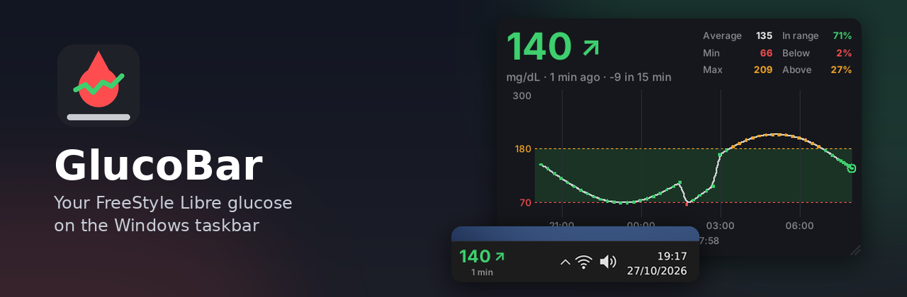</p>

<p align="center">
  <a href="https://github.com/jackfaz/glucobar/releases/latest"></a>
  <a href="https://github.com/jackfaz/glucobar/releases"></a>
  <a href="https://github.com/jackfaz/glucobar/actions/workflows/build.yml"></a>
  
  
  <a href="LICENSE"></a>
</p>

<p align="center">
  <a href="https://github.com/jackfaz/glucobar/releases/latest"><b>Scarica per Windows</b></a> ·
  <a href="#in-evidenza">In evidenza</a> ·
  <a href="#installazione">Installazione</a> ·
  <a href="#mac-beta">Mac</a> ·
  <a href="#configurare-librelinkup">Configurare LibreLinkUp</a> ·
  <a href="#uso">Uso</a> ·
  <a href="#sensori">Sensori</a> ·
  <a href="CHANGELOG.md">Changelog</a> ·
  <a href="README.md">English</a>
</p>

GlucoBar mostra la glicemia del tuo FreeStyle Libre o Dexcom sul PC con Windows, così mentre
lavori puoi tenerla d'occhio senza prendere il telefono. Legge l'ultimo valore da LibreLinkUp
(il servizio di condivisione di Abbott) o da Dexcom Share, e lo mostra con la freccia di
tendenza e da quanti minuti è stato misurato. Funziona anche con i siti Nightscout e
Nocturne, e c'è una [versione per Mac](#mac-beta) in beta.

Puoi vederla in quattro posti, uno o più insieme: sulla barra delle applicazioni accanto
all'orologio, come icona nell'area di notifica, in una finestrella sempre in primo piano o in
un pannello più grande sul desktop, con il grafico delle ultime 12 ore e qualche statistica.
Funziona anche sul secondo monitor e si nasconde quando un video o un gioco è a schermo intero.

La password resta cifrata nel Gestione credenziali di Windows e viene inviata solo ai server
del produttore del sensore. GlucoBar è gratuito, open source (MIT) e disponibile in italiano, inglese,
spagnolo, francese, tedesco e portoghese.

| Sulla barra | Finestrella |
|---|---|
| 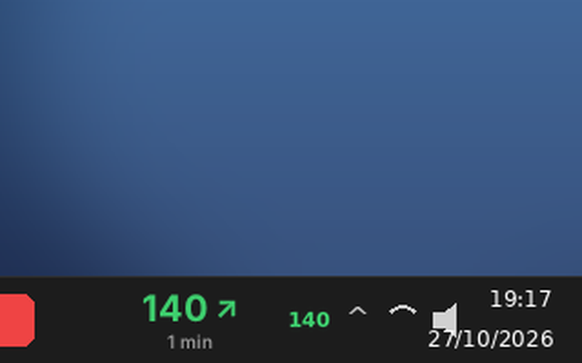 | 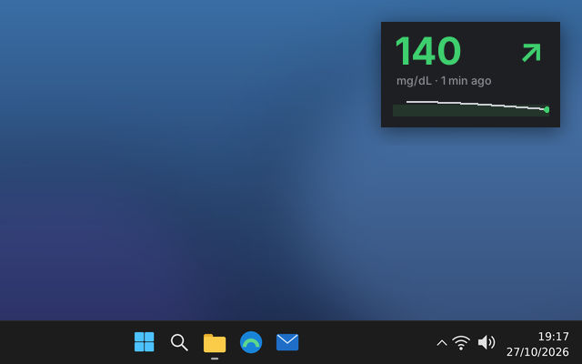 |
| Valore, freccia e minuti accanto all'orologio. | Sempre in primo piano, con il grafico delle ultime 3 ore. La sposti dove vuoi. |
| **Pannello sullo sfondo** | **Icona vicino all'orologio** |
| 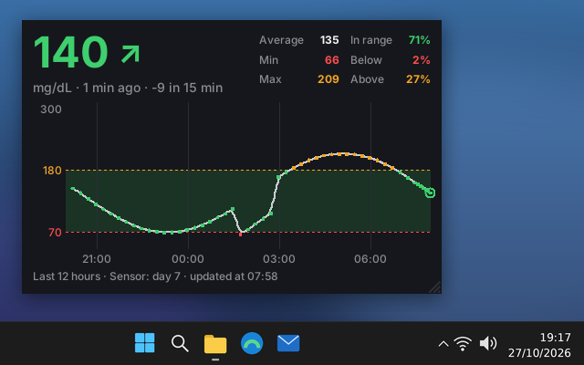 | 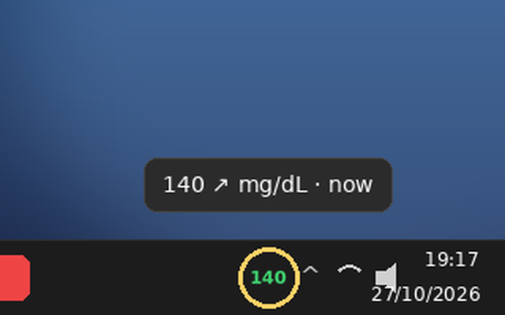 |
| Dietro le finestre: grafico delle ultime 3, 6 o 12 ore, media, minimo, massimo, tempo nel range, variazione in 15 minuti e giorno del sensore. Ridimensionabile. | Il numero colorato nell'area di notifica. Passandoci sopra vedi freccia e minuti. |

Colori: verde nel range (70–180 mg/dL), arancione sopra 180, rosso sotto 70 o sopra 250,
grigio se il dato è di più di 15 minuti fa. Soglie e colori si cambiano dalle Impostazioni.

## In evidenza

### Il grafico, a un secondo di distanza

<p align="center">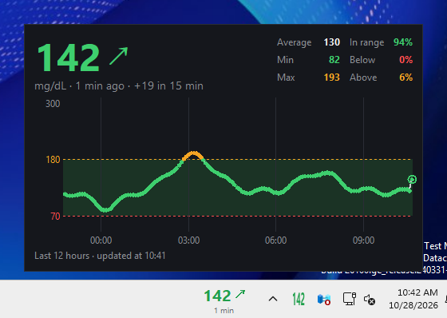</p>

Tieni il mouse sul valore della barra per un secondo e, con una breve dissolvenza, si apre
subito sopra il grafico completo: il valore, la variazione negli ultimi 15 minuti, media,
minimo, massimo, tempo nel range e le ultime ore. Sposti il mouse e si chiude.

### I tuoi colori

| Scuro | Chiaro |
|---|---|
| 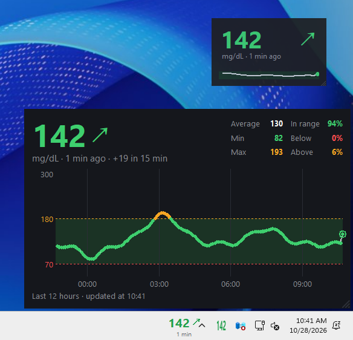 | 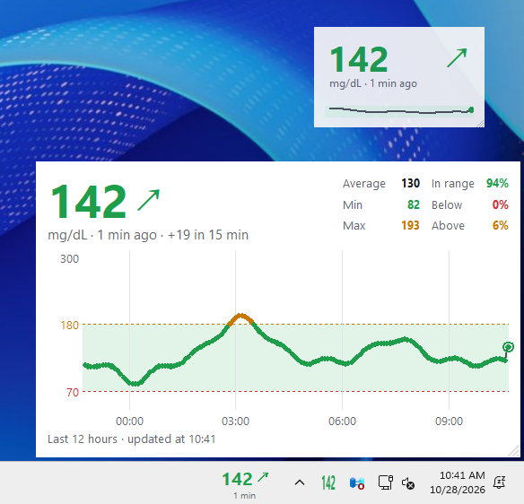 |
| **Adatti al daltonismo** | **Colori scelti da te** |
| 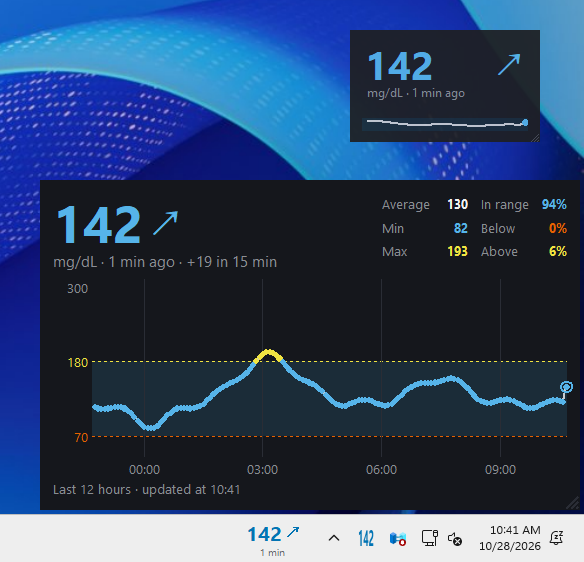 | 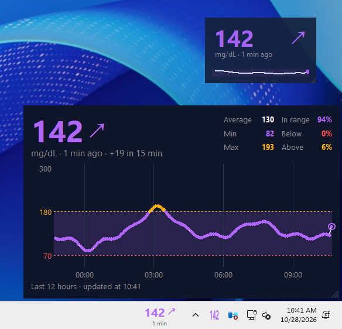 |

Tema chiaro, scuro o automatico (segue Windows o macOS), una tavolozza leggibile con le forme
più comuni di daltonismo, o un colore tuo per tutto: il valore nel range, alto, molto alto,
basso e vecchio, gli sfondi, i testi, il grafico e la griglia.

### Menu rapido, impostazioni complete

| Menu col clic destro | Impostazioni |
|---|---|
| 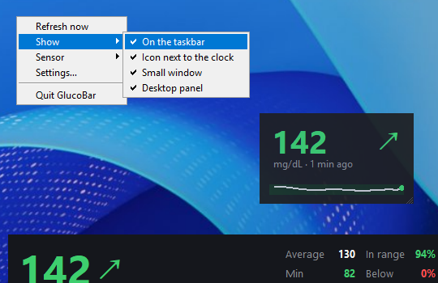 | 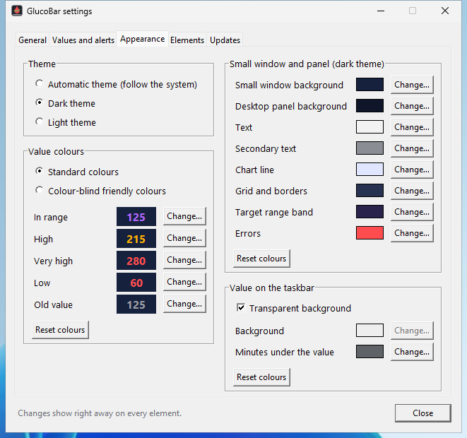 |
| Clic destro su qualsiasi elemento di GlucoBar per le azioni rapide: aggiorna, cosa mostrare, sensore, impostazioni. | Tutto il resto, diviso in schede: account, lingua e unità; soglie, avvisi e delta; tema e colori; elementi; aggiornamenti. Ogni modifica si vede subito. |

Gli screenshot sono in inglese; GlucoBar parla anche italiano, spagnolo, francese, tedesco e
portoghese.

### Avvisi, sensore e aggiornamenti

<p align="center">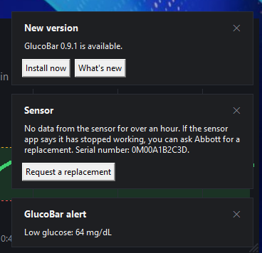</p>

- **Avvisi facoltativi** per glicemia bassa, molto alta o nessun dato. Spenti di default, e
  non sostituiscono gli allarmi del sensore.
- **Sensore** (FreeStyle Libre): giorno di utilizzo, un promemoria prima della fine e, se si
  ferma prima del tempo, un pulsante che apre il modulo di sostituzione del produttore con il
  numero di serie già copiato.
- **Aggiornamenti dall'app**: un clic installa la nuova versione e tiene le impostazioni;
  *Impostazioni → Aggiornamenti → Cerca aggiornamenti adesso* controlla subito.

### E inoltre

- **Delta**: la variazione dalla lettura precedente sotto il valore, es. "3 min +5".
- **Aggiorna ogni** da 10 secondi a 5 minuti.
- **Pannello sempre in primo piano**, nascosto quando un video o un gioco è a schermo intero.
- **Qualsiasi barra**: a sinistra, a destra o in alto (Windows 10), nascosta automaticamente,
  sul secondo monitor.
- **Più persone** seguite con lo stesso account LibreLinkUp.

> **GlucoBar non è un dispositivo medico.** Non usarlo per decidere dosi di insulina o per
> trattare un'ipo: fa fede il lettore o l'app ufficiale. Usa un'API non ufficiale che Abbott
> può cambiare in qualsiasi momento.

## Sensori

| Sensore | Letto tramite | Stato |
|---|---|---|
| FreeStyle Libre (Libre 2, Libre 3 e versioni Plus) | LibreLinkUp | Supportato |
| Dexcom G6, G7, ONE+ | Dexcom Share | Beta, cerchiamo chi lo provi |
| Qualsiasi sensore che invia i dati a Nightscout o Nocturne (Medtronic, Eversense, xDrip+, Juggluco, AndroidAPS, Loop, …) | API di Nightscout | Beta, cerchiamo chi lo provi |
| Medtronic Guardian / Simplera | CareLink | In valutazione |

Il supporto per Dexcom e Nightscout è nuovo e finora è stato provato solo con server
simulati. Se li usi, facci sapere se funziona nelle [Discussions](../../discussions)
o in una [issue](../../issues).

Vorresti un altro sensore? [Apri una issue](../../issues) e dicci quale.

## Installazione

1. **Attiva la condivisione sul telefono (una volta sola).**
   - **FreeStyle Libre:** condividi le letture con LibreLinkUp usando il tuo account
     LibreLink. Bastano cinque minuti: vedi [Configurare LibreLinkUp](#configurare-librelinkup).
   - **Dexcom:** nell'app **Dexcom** attiva la **condivisione (Share)** e invita almeno un
     follower. GlucoBar entra con il tuo account Dexcom, non con quello del follower.
   - **Nightscout o Nocturne:** serve un sito che riceve già le tue letture. Se non è
     pubblico, crea un token in sola lettura. Nightscout: *Admin Tools → Add new Subject*,
     ruolo **readable**, e copia il token. Nocturne: *Settings → Connectors → API tokens →
     Create API token*, con il permesso di lettura **Blood glucose**.
2. Scarica l'installer dalla pagina [Release](../../releases/latest), oppure direttamente con
   questo link, che dà sempre l'ultima versione:
   https://github.com/jackfaz/glucobar/releases/latest/download/GlucoBar-Setup.exe.
   Non servono permessi di amministratore.
3. Scegli la lingua dell'installazione, spunta cosa mostrare (con le anteprime) e se avviare
   GlucoBar all'accensione del PC.
4. Al primo avvio scegli il sensore e inserisci l'account: l'email **LibreLinkUp** per
   FreeStyle Libre (la stessa di LibreLink, se hai seguito la guida qui sotto), oppure email,
   telefono (con prefisso) o nome utente **Dexcom**, oppure indirizzo (quello che apri nel
   browser) e token del tuo sito **Nightscout** o **Nocturne**.

Windows può mostrare *"Windows ha protetto il PC"* perché l'installer non è ancora firmato
digitalmente: clicca *Ulteriori informazioni → Esegui comunque*. Ogni release riporta
l'impronta SHA-256 dell'installer e il link alla sua scansione su VirusTotal, così puoi
controllare il file prima di avviarlo.

## Mac (beta)

Sul Mac il valore sta nella **barra dei menu**, accanto all'orologio; cliccandoci si apre il
menu di GlucoBar. La finestrella e il pannello sul desktop funzionano come su Windows. Serve un
Mac con chip Apple (M1 o successivi) e macOS 11 o successivo.

1. Scarica `GlucoBar-mac.dmg`:
   https://github.com/jackfaz/glucobar/releases/latest/download/GlucoBar-mac.dmg
2. Aprilo e trascina **GlucoBar** su **Applicazioni**.
3. Apri GlucoBar da Applicazioni. L'app non è ancora autenticata da Apple, quindi la prima
   volta macOS la blocca: apri **Impostazioni di Sistema → Privacy e sicurezza**, scorri fino al
   messaggio su GlucoBar e clicca **Apri comunque** (su macOS 14 e precedenti puoi anche fare
   Ctrl+clic sull'app → **Apri**). Serve solo la prima volta.
4. Scegli il sensore e inserisci l'account, come su Windows.

Dal menu puoi anche attivare **Apri all'accesso**. Le password stanno nel **Portachiavi** di
macOS (voci `GlucoBar:LibreLinkUp`, `GlucoBar:Dexcom`, `GlucoBar:Nightscout`) e le impostazioni
in `~/Library/Application Support/GlucoBar/config.json`.

Il comando `glucobar` è dentro l'app. Per usarlo da qualsiasi terminale:

```text
sudo mkdir -p /usr/local/bin
sudo ln -sf /Applications/GlucoBar.app/Contents/MacOS/glucobar-cli /usr/local/bin/glucobar
```

Per disinstallare: disattiva *Apri all'accesso*, chiudi GlucoBar, lancia `glucobar forget` se
vuoi cancellare password e impostazioni, e sposta GlucoBar nel Cestino.

## Configurare LibreLinkUp

GlucoBar legge il FreeStyle Libre tramite LibreLinkUp, l'app di Abbott per condividere le
letture con familiari e assistenti. Si configura una volta sola, dal telefono, in pochi
minuti. La strada più semplice è condividere con te stesso, usando l'account che hai già
nell'app LibreLink.

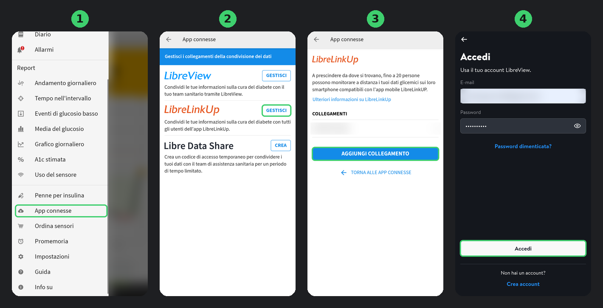

1. Nell'app **LibreLink** (quella che legge il sensore) apri il menu e tocca
   **App connesse**.
2. Accanto a **LibreLinkUp** tocca **Gestisci**.
3. Tocca **Aggiungi collegamento**, inserisci il tuo nome e **l'email del tuo account
   LibreLink** e invia l'invito.
4. Installa l'app **LibreLinkUp** dall'App Store o da Google Play, tocca **Accedi** e usa **la
   stessa email e la stessa password** di LibreLink (LibreLinkUp lo chiama "account
   LibreView"). Accetta l'invito e i termini d'uso: in LibreLinkUp compare la tua glicemia.
5. In GlucoBar scegli *FreeStyle Libre* e inserisci la stessa email e la stessa password.

Dopo puoi disinstallare LibreLinkUp dal telefono. Se un giorno servisse di nuovo, per esempio
quando Abbott aggiorna i termini d'uso, te lo dice GlucoBar.

Puoi anche invitare un'altra email, per esempio quella di un familiare, e usare quell'account
in GlucoBar: funziona allo stesso modo.

**Se GlucoBar mostra un errore**

| Messaggio | Cosa fare |
|---|---|
| *Email o password errate* | Controlla di riuscire ad accedere all'app LibreLinkUp con la stessa email e password. |
| *Nessun paziente collegato* | L'invito non è ancora stato accettato: apri LibreLinkUp e accettalo, oppure rimandalo da LibreLink. |
| *Apri l'app LibreLinkUp sul telefono e accetta i termini d'uso* | Apri LibreLinkUp, accetta, poi clic destro su GlucoBar → *Aggiorna ora*. |
| Il valore resta grigio | Nessuna lettura nuova da 15 minuti: controlla che il telefono sia vicino al sensore e connesso. |

## Uso

- **Clic destro su qualsiasi elemento di GlucoBar** (l'icona, il valore sulla barra, la
  finestrella o il pannello): aggiorna, *Mostra* (spunta gli elementi che vuoi), *Sensore*,
  *Impostazioni…*, esci. **Doppio clic**: aggiorna subito.
- **Impostazioni…** contiene tutto il resto, diviso in schede: *Generale* (account, lingua,
  unità, ogni quanto aggiornare, avvio con Windows), *Valori e avvisi* (soglie, avvisi,
  delta), *Aspetto* (tema e tutti i colori), *Elementi* (cosa mostrare, valore sulla barra,
  pannello) e *Aggiornamenti* (versione installata, *Cerca aggiornamenti adesso*,
  aggiornamenti automatici).
- Windows 11 nasconde le icone nuove sotto la freccetta **^**: trascina l'icona di GlucoBar
  sulla barra per tenerla sempre visibile.
- Barra sul secondo monitor: attiva *Impostazioni → Personalizzazione → Barra delle applicazioni →
  Comportamenti della barra delle applicazioni → Mostra la barra delle applicazioni su tutti gli
  schermi*, poi clic destro sul valore → *Sposta sull'altro monitor*.
- Pannello sullo sfondo e finestrella: trascinali per spostarli, trascina l'angolo in basso a
  destra per ridimensionarli. Sul pannello, clic destro per il periodo del grafico, per
  bloccarlo o per tenerlo *Sempre in primo piano* sopra le altre finestre (si nasconde
  quando un'app è a schermo intero).
- Valore sulla barra: tieni il mouse sopra per un secondo e compare il grafico completo
  subito sopra. Clic destro → *Dimensione* per rimpicciolirlo o ingrandirlo.
  *Impostazioni → Valori e avvisi → Mostra la variazione (delta)* aggiunge la variazione
  dalla lettura precedente (es. "3 min +5").
- *Impostazioni…*: tema (chiaro, scuro o automatico, segue Windows o macOS), tutti i colori
  (il valore nel range, alto, molto alto, basso e vecchio; sfondi, testi, grafico e griglia
  di finestrella e pannello, per ciascun tema; lo sfondo del valore sulla barra) e soglie.
  Ogni modifica si vede subito su tutti gli elementi.
- *Avvisi* (spenti di default): un messaggio quando la glicemia è bassa, molto alta, o quando
  da un po' non arrivano dati nuovi. Arrivano dal servizio online del sensore, con qualche
  minuto di ritardo, e solo col computer acceso: **non sostituiscono gli allarmi del
  sensore**.
- *Sensore*: con LibreLinkUp, il giorno di utilizzo e il numero di serie (cliccalo per
  copiarlo), un promemoria 24 ore e 2 ore prima della fine, e un messaggio se il sensore
  sembra essersi fermato o è stato sostituito prima del tempo. *Chiedi la sostituzione del
  sensore…* apre la pagina del produttore per il tuo paese e copia il numero di serie, pronto
  da incollare nel modulo.
- *Persona*: se il tuo account LibreLinkUp segue più persone, scegli chi mostrare.
- Quando esce una nuova versione GlucoBar te lo dice e la prima voce del menu la installa: su
  Windows scarica l'installer, ne controlla l'impronta SHA-256 e lo installa in silenzio, poi
  si riapre con le stesse impostazioni. Spunta *Installa da solo le nuove versioni* per non
  sentirti chiedere niente. Sul Mac apre la pagina da cui scaricarla.

## Terminale

L'installer aggiunge il comando `glucobar` a ogni nuovo terminale:

```text
glucobar setup                 configurazione guidata: ↑/↓ per scegliere, Spazio per spuntare, Invio
glucobar status                glicemia attuale, es. "133 ↘ mg/dL · 2 min fa"
glucobar set unit=mmol/L low=80
glucobar set elements=desktop,tray autostart=true
glucobar get                   tutte le impostazioni
glucobar login                 cambia sensore o account
glucobar start | stop          avvia GlucoBar | chiudilo
glucobar forget                cancella password, token e impostazioni
glucobar report                riepilogo per le segnalazioni, copiato negli appunti
```

Se GlucoBar è aperto, applica le nuove impostazioni entro due secondi.

Installazione silenziosa con le tue scelte (comoda per script e winget):

```text
GlucoBar-Setup-0.9.4.exe /VERYSILENT /ELEMENTS=taskbar,tray /SENSOR=libre /LANG=it
```

## Impostazioni

`%APPDATA%\GlucoBar\config.json`:

| Chiave | Predefinito | Significato |
|---|---|---|
| `source` | `libre` | `libre` (LibreLinkUp), `dexcom` (Dexcom Share) oppure `nightscout` |
| `dexcom_region` | `ous` | Dove è stato creato l'account Dexcom: `ous` (fuori dagli USA), `us`, `jp` |
| `elements` | `["taskbar", "tray"]` | Cosa mostrare, in qualsiasi combinazione: `taskbar`, `tray` (icona vicino all'orologio), `window`, `desktop` |
| `low` / `high` / `very_high` | 70 / 180 / 250 | Soglie in mg/dL |
| `unit` | `mg/dL` | oppure `mmol/L` |
| `stale_minutes` | 15 | Oltre questo il valore diventa grigio |
| `hover_chart` | true | Mostra il grafico completo tenendo il mouse sul valore della barra |
| `show_delta` | false | Mostra la variazione dalla lettura precedente, ogni 5 minuti, sulla barra e nella finestrella |
| `refresh_seconds` | 60 | Ogni quanto leggere il dato, da 10 a 3600 secondi (anche da Impostazioni → Generale) |
| `language` | `auto` | `it`, `en`, `es`, `fr`, `de`, `pt` |
| `taskbar_monitor` | 1 | 1 = monitor principale, 2 = secondo, … |
| `taskbar_offset` | 0 | Pixel di spostamento (negativo = a sinistra) |
| `taskbar_bg` | auto | Colore della tua barra, es. `#202020`, se vedi un alone attorno alle cifre |
| `taskbar_transparent` | true | `false` per uno sfondo pieno |
| `taskbar_scale` | 1.0 | Dimensione del valore sulla barra, 0,85–1,25 (anche dal clic destro → *Dimensione*) |
| `window_scale` | 1.0 | Dimensione della finestrella, 0,8–2,5 (anche trascinando l'angolo in basso a destra) |
| `desktop_hours` | 12 | Periodo del grafico del pannello: 3, 6 o 12 |
| `desktop_alpha` | 0.92 | Opacità del pannello (1 = pieno) |
| `desktop_on_top` | false | Tiene il pannello sopra le altre finestre (nascosto con le app a schermo intero) |
| `theme` | `auto` | `auto` (segue Windows o macOS), `dark` o `light` |
| `palette` | `standard` | `standard` oppure `colorblind` (adatta al daltonismo) |
| `color_in_range` / `color_high` / `color_very_high` / `color_low` / `color_stale` | auto | Un colore tuo per il valore, es. `#00c060`; `auto` = quello della tavolozza |
| `taskbar_text` | auto | Colore dei minuti sotto il valore sulla barra |
| `alert_low` / `alert_high` / `alert_stale` | false | Avvisi per valore basso (sotto `low`), molto alto (sopra `very_high`) e nessun dato (`stale_minutes`) |
| `update_check` | true | Controlla una volta al giorno se c'è una nuova versione |
| `auto_update` | false | Windows: installa le nuove versioni senza chiedere |
| `sensor_life_days` | 14 | LibreLinkUp: quanto dura il sensore, per i promemoria di fine (15 per i sensori Plus) |

Log: `%APPDATA%\GlucoBar\glucobar.log`.

Se usavi la prima versione (script Python con `.glicemia_widget.json`), al primo avvio
GlucoBar importa da solo impostazioni e password. Poi puoi cancellare quel file.

## Privacy

- La password è salvata **cifrata nel Gestione credenziali di Windows** (voci
  `GlucoBar:LibreLinkUp`, `GlucoBar:Dexcom` e `GlucoBar:Nightscout` per il token), mai nel
  file delle impostazioni.
- GlucoBar comunica **solo con i server del produttore del sensore** (LibreView di Abbott o
  Dexcom Share) **o con il tuo sito Nightscout**. Nessuna statistica.
- Una volta al giorno chiede a GitHub qual è l'ultima versione di GlucoBar (una richiesta
  pubblica che non manda dati su di te o sulle tue letture), e scarica l'installer da GitHub
  solo quando installi un aggiornamento. Si spegne dal menu o con
  `glucobar set update_check=false`.
- *Chiedi la sostituzione del sensore…* apre solo la pagina del produttore nel browser e copia
  il numero di serie negli appunti: GlucoBar non invia niente.
- La disinstallazione chiede se eliminare anche impostazioni e password (anche il vecchio
  `.glicemia_widget.json`). Puoi farlo anche in qualsiasi momento con `GlucoBar.exe --forget`.

## Firma del codice

L'installer non è ancora firmato digitalmente. Quando GlucoBar sarà più diffuso faremo
domanda al programma di [SignPath Foundation](https://signpath.org), che firma gratuitamente
i progetti open source.

- Chi modifica e rivede il codice: [jackfaz](https://github.com/jackfaz)
- Chi approva le release da firmare: [jackfaz](https://github.com/jackfaz)

Vengono firmati solo gli installer compilati da GitHub Actions a partire da questo repository.

GlucoBar non trasmette nessuna informazione ad altri sistemi in rete, se non su richiesta
esplicita di chi lo installa o lo usa. Le uniche connessioni sono verso i server del
produttore del sensore (Abbott LibreView o Dexcom Share) o verso il sito Nightscout
dell'utente, con l'account inserito dall'utente, più un controllo giornaliero dell'ultima
versione su GitHub, che l'utente può spegnere.

## Perché "sulla" barra e non "dentro"?

Su Windows 11 25H2 una finestra agganciata alla barra (`SetParent` su `Shell_TrayWnd`, la
tecnica di TrafficMonitor) viene disegnata *sotto* lo sfondo acrilico della barra e non si vede.
GlucoBar tiene invece una finestra trasparente, senza bordi e sempre in primo piano esattamente
sopra la barra, e la riporta sopra ogni 500 ms.

## Compilare dai sorgenti

```bat
pip install -r requirements.txt pyinstaller
python -m unittest discover -s tests
python run_glucobar.py --mode desktop          :: avvio senza compilare
pyinstaller --noconfirm --clean glucobar.spec
python tools\previews_to_bmp.py
iscc /DAppVersion=0.9.4 installer\glucobar.iss    :: serve Inno Setup 6
```

Le release le crea GitHub Actions (`.github/workflows/build.yml`): in *Actions → Build installer →
Run workflow* spunta *release* per pubblicare la versione scritta in `glucobar/__init__.py`
(funziona anche pubblicando un tag tipo `v0.9.4`). Le anteprime delle modalità si creano con
`tools/compose_previews.py`.

Ogni build installa anche l'ultima release pubblicata, la apre e ci installa sopra la nuova in
silenzio (come winget), controllando che impostazioni, password e scelte restino. Altri due
workflow partono da soli:

- *Live check* (ogni giorno): legge un dato dai veri LibreLinkUp, Dexcom Share e Nightscout
  con gli account salvati nei secret del repository (`LIBRE_EMAIL`, `LIBRE_PASSWORD`,
  `DEXCOM_USER`, `DEXCOM_PASSWORD`, `DEXCOM_REGION`, `NIGHTSCOUT_URL`, `NIGHTSCOUT_TOKEN`; un
  servizio senza secret si salta). Il log dice solo "ok" o l'errore.
- *Soak test* (ogni settimana, o a mano scegliendo la durata): tiene GlucoBar aperto con una
  lettura ogni 10 secondi e cambi di tema, e fallisce se memoria, handle o oggetti grafici
  continuano a crescere.

## Riconoscimenti e marchi

GlucoBar è un progetto open source indipendente, non affiliato né approvato da Abbott o
Dexcom. FreeStyle, Libre, LibreLink e LibreLinkUp sono marchi di Abbott; Dexcom è un marchio
di Dexcom, Inc. I dettagli delle API LibreLinkUp e Dexcom Share vengono dal lavoro della
comunità open source sul diabete (Nightscout, pydexcom e altri). Nightscout è un progetto
open source della Nightscout Foundation; GlucoBar usa la sua API documentata.

GlucoBar è gratuito e lo resterà. Se ti è utile e vuoi sostenerlo, puoi
[fare una donazione con PayPal](https://paypal.me/giacomofazioli).

Licenza: [MIT](LICENSE).
